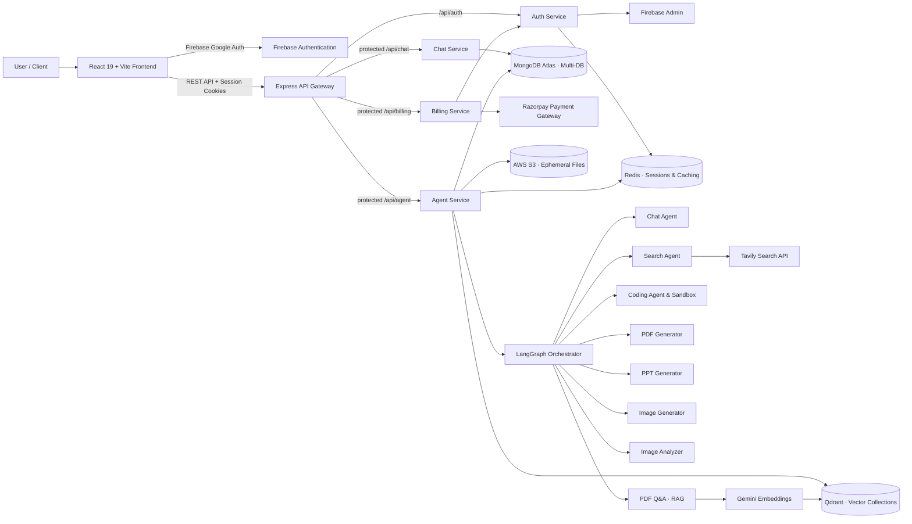
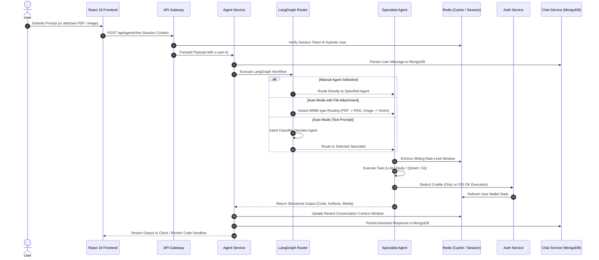

# Kaido — Autonomous Multi-Agent AI Platform

<p align="center">
  <strong>A production-grade, multi-agent AI orchestration platform — not just a chatbot, but a routed distributed system of specialized AI agents working behind an interactive canvas workspace.</strong>
</p>

<p align="center">
  <a href="https://kaido-sage.vercel.app" target="_blank">
    
  </a>
  <a href="https://kaido-ihjm.onrender.com" target="_blank">
    
  </a>
  <a href="https://github.com/deveshups-ux/Kaido">
    
  </a>
</p>

<p align="center">
  
  
  
  
  
  
  
  
  
  
  
</p>

<p align="center">
  <a href="https://kaido-sage.vercel.app">🌐 Live Demo</a> ·
  <a href="https://www.linkedin.com/in/devesh-tiwari-642b03374">💼 LinkedIn</a> ·
  <a href="https://github.com/deveshups-ux">🐙 GitHub Profile</a> ·
  <a href="https://github.com/deveshups-ux/Kaido">📦 Repository</a>
</p>

> **Status:** 🟢 **Production Live** — Frontend hosted globally on Vercel Edge, Backend microservices live on Render Cloud, MongoDB Atlas multi-cluster with persistent session recovery, and Redis in-memory session caching.

---

## Table of Contents

- [Overview](#overview)
- [Key Features & Highlights](#key-features--highlights)
- [Screenshots](#screenshots)
- [Agents at a Glance](#agents-at-a-glance)
- [System Architecture](#system-architecture)
- [Request Flow & Lifecycle](#request-flow--lifecycle)
- [Engineering Highlights](#engineering-highlights)
- [Tech Stack](#tech-stack)
- [Repository Layout](#repository-layout)
- [Production Deployment](#production-deployment)
- [Local Setup](#local-setup)
- [How Routing Works](#how-routing-works)
- [Plans, Usage & Quotas](#plans-usage--quotas)
- [Author & Connect](#author--connect)

---

## Overview

**Kaido** is a full-stack, autonomous AI orchestration platform designed to replace monolithic chatbot wrappers with a routed distributed architecture of specialized AI agents. Built around a **LangGraph-driven routing graph**, Kaido autonomously analyzes user intent and attachments to delegate tasks to the optimal specialist: general reasoning, live web search, multi-file code synthesis, presentation creation, document reporting, generative image synthesis, visual analysis, or vector-backed PDF question answering.

Most personal AI projects stop at single-model API calls. Kaido goes deeper into production-grade systems engineering:
- **Autonomous Multi-Agent Routing** with dynamic intent detection and file-type-first branching.
- **Interactive In-Browser Code Canvas** with multi-file Monaco editor and live sandboxed iframe preview.
- **Enterprise Data Layer** featuring a Multi-Database MongoDB Atlas proxy and crash-resilient Redis session hydration.
- **Production SaaS Monetization** with real-time credit metering, sliding rate limits, and Razorpay HMAC-verified upgrades.

<p align="center">
  🧩 Decoupled Microservices &nbsp;·&nbsp; 🤖 8 Autonomous Agents &nbsp;·&nbsp; 💻 Live Code Sandbox &nbsp;·&nbsp; 💳 Full SaaS Billing &nbsp;·&nbsp; 📄 Qdrant Vector RAG
</p>

---

## Key Features & Highlights

### 🛡️ Platform & Authentication
- **Google Sign-In via Firebase Authentication**, verified server-side with Firebase Admin SDK.
- **Crash-Resilient Session Store**: Redis-backed HTTP-only cookie authentication with a transparent in-memory fallback proxy to prevent user lockouts.
- **Centralized API Gateway**: Proxies incoming traffic, terminates CORS policies, and enforces route protection middleware across microservices.
- **Multi-Tenant MongoDB Atlas Layer**: Resilient cross-database session recovery ensuring zero message or conversation history loss.

### 🤖 8 Specialized Agents, One Dynamic Router
- **Auto-Router** — LangGraph workflow that inspects user prompt semantics and MIME attachments to route requests autonomously.
- **Chat Agent** — Conversational reasoning, architectural explanations, and technical writing (`Groq / gpt-oss-120b`).
- **Search Agent** — Real-time live web indexing and source attribution powered by Tavily Search.
- **Coding Agent & Canvas Sandbox** — Intent-aware coding engine that classifies code requests (generate, review, debug, optimize) and renders full HTML/CSS/JS applications in an interactive multi-tab Monaco editor with real-time live preview.
- **PDF Generator Agent** — Compiles structured topic outlines into server-rendered downloadable PDF reports stored on AWS S3 (with 24-hour expiring download links).
- **PPT Generator Agent** — Generates complete presentation slide decks (`.pptx`) with structured formatting.
- **Image Generator Agent** — Expands user prompts into rich visual descriptors and synthesizes photorealistic images directly in the chat stream.
- **Image Analyzer (Vision)** — Multimodal image understanding powered by Gemini Flash: extracts text, decodes charts, and answers visual queries.
- **PDF Q&A (RAG)** — Full Retrieval-Augmented Generation pipeline: uploaded PDFs are chunked, embedded via Gemini Embeddings, stored in isolated Qdrant vector collections, and queried strictly against source documents.

### 💳 SaaS Quotas & Monetization
- **Per-Agent Sliding Rate Limits** backed by Redis to prevent API quota exhaustion.
- **Transactional Credit Accounting**: Credits are deducted strictly *after* successful response generation.
- **Tiered Plans (Free, Starter ₹199, Pro ₹499)** with Razorpay checkout and HMAC-SHA256 signature verification.

---

## Screenshots

<!-- Screenshot files live in /screenshots -->

| | |
|---|---|
| **Autonomous Workspace Dashboard** <br>  | **Interactive Code Canvas (Live Sandbox)** <br>  |
| **SaaS Billing & Credit Engine** <br>  | **Dynamic PDF Report Generation** <br>  |
| **Multimodal Generative Vision** <br>  | **Vector-Based PDF RAG (Qdrant)** <br>  |

---

## Agents at a Glance

| Agent | Core Responsibility | Underlying Models & Tools | Output Format |
| :--- | :--- | :--- | :--- |
| **Chat** | General reasoning, logic & technical conversation | Groq (`gpt-oss-120b`) | Streaming Markdown |
| **Search** | Real-time queries & breaking information retrieval | Tavily Search API + Groq | Cited text with source links |
| **Coding** | Autonomous code synthesis & intent classification | DeepSeek via OpenRouter + Monaco Editor | Multi-file code + Live sandbox iframe |
| **PDF Generator** | Structured technical report compilation | Groq (structured JSON) + PDFKit + AWS S3 | Downloadable PDF (24h pre-signed link) |
| **PPT Generator** | Topic-to-slide presentation generation | Groq + pptxgenjs + AWS S3 | Downloadable PPTX (24h pre-signed link) |
| **Image Generator**| Photorealistic prompt expansion & generation | Groq (prompt engineer) + Generative Vision | Rendered PNG via AWS S3 |
| **Image Analyzer** | Multimodal OCR, diagram analysis & chart decoding | Google Gemini Flash | Detailed Markdown analysis |
| **PDF Q&A (RAG)**  | Strict grounding & document question answering | Gemini Embeddings + Qdrant Vector DB | Fact-verified citations |

---

## System Architecture



---

## Request Flow & Lifecycle



---

## Engineering Highlights

A few core architectural decisions that separate Kaido from common boilerplate demos:

1. **File-Type-First Deterministic Routing:**  
   When a user uploads a document or image, Kaido bypasses LLM classification entirely. MIME-type inspection routes PDFs straight to the Vector RAG pipeline and images to the Vision Analyzer, eliminating latency and LLM cost for attachment handling.

2. **Isolated Vector Collections Per Document:**  
   Rather than mixing all user embeddings into a single shared vector index, every uploaded PDF provisions an isolated collection in Qdrant. Context from one user's file can never contaminate another file's retrieval.

3. **In-Browser Code Execution Canvas (Artifacts):**  
   The coding agent outputs structured multi-file code blocks (`index.html`, `style.css`, `script.js`). The frontend loads them directly into Monaco Editor instances and dynamically compiles an isolated iframe sandbox for instant, zero-latency execution.

4. **Resilient Multi-DB MongoDB Atlas Proxy:**  
   Engineered a multi-database Atlas model helper to maintain reliable data integrity and session history across dynamic collections, completely resolving multi-tenant session connection drops.

5. **Crash-Resilient Redis Session Store:**  
   Integrated Redis for sub-second user session caching with an automatic, non-blocking in-memory fallback proxy to guarantee zero authentication downtime if cloud Redis reconnects.

6. **Server-Side HMAC-SHA256 Payment Verification:**  
   Razorpay order creation and webhook verification use strict HMAC-SHA256 cryptographic signatures. Credit allocations are verified exclusively against server-side plan registries, completely preventing client-side credit spoofing.

---

## Tech Stack

| Domain | Technologies & Libraries |
| :--- | :--- |
| **Frontend** | React 19, Vite, Redux Toolkit, Tailwind CSS v4, Monaco Editor (`@monaco-editor/react`), Framer Motion, Axios |
| **Authentication** | Firebase Authentication, Firebase Admin SDK |
| **API Gateway & Routing**| Express.js, `express-http-proxy`, CORS, Cookie-Parser |
| **Backend Microservices**| Node.js, Express.js, TypeScript architecture, Multer |
| **Databases & Caching**| MongoDB Atlas (Mongoose ODM), Redis (In-Memory Session & Rate Limiting) |
| **AI Orchestration** | LangGraph, LangChain |
| **AI & LLM Providers** | Groq (`gpt-oss-120b`), OpenRouter (DeepSeek), Google Gemini Flash |
| **Vector DB & Search** | Qdrant Cloud (Vector Database), Gemini Text Embeddings, Tavily Search API |
| **Cloud Storage & Media**| AWS S3 (Pre-signed expiring links), PDFKit, PPTXGenJS |
| **Payments** | Razorpay Node.js SDK (HMAC Verification) |
| **DevOps & Hosting** | Docker, Vercel (Edge Frontend), Render (Cloud Microservices), UptimeRobot (Keep-Alive) |

---

## Repository Layout

```text
Kaido/
├── frontend/                  # React 19 + Vite User Interface
│   ├── src/
│   │   ├── components/        # Chat, Sandbox Canvas, Billing Drawer, Agent Selector
│   │   ├── store/             # Redux Toolkit State Management
│   │   └── utils/             # API clients and Firebase configuration
│   └── package.json
├── backend/
│   ├── gateway/               # Centralized Express Gateway & Route Protection
│   ├── services/
│   │   ├── auth/              # Firebase token validation, Sessions, Credit sync
│   │   ├── chat/              # Conversations, Message persistence, Multi-DB proxy
│   │   ├── billing/           # Razorpay order generation & HMAC verification
│   │   └── agent/             # LangGraph routing workflow & Specialist Agents
│   │       ├── agents/        # chat, search, coding, pdf, ppt, vision, imageAnalyzer, pdfRag
│   │       ├── config/        # LLM routing, embeddings, vector store, S3
│   │       └── utils/         # Credit accounting, PDF/PPT compilers, S3 helpers
│   ├── shared/                # Resilient Redis proxy & cross-service DB helpers
│   └── docker-compose.yml     # Containerized local Redis service
└── README.md
```

---

## Production Deployment

Kaido is deployed live across modern cloud infrastructure:

- **Frontend Application:** Deployed on **Vercel** with global edge CDN caching (`https://kaido-sage.vercel.app`).
- **Backend API Gateway & Services:** Deployed as containerized microservices on **Render Cloud** (`https://kaido-ihjm.onrender.com`).
- **Database:** Hosted on **MongoDB Atlas** with multi-collection resilience.
- **In-Memory Store:** Distributed Redis session store.
- **24/7 Availability:** Continuous health ping monitoring via **UptimeRobot** preventing container sleep states.

---

## Local Setup

### Prerequisites

- Node.js 20+
- MongoDB instance (local or MongoDB Atlas)
- Redis instance (Docker supported)
- Qdrant cluster (Cloud or local container)
- Firebase project with Google Authentication enabled
- Cloud API keys: Groq, Gemini, Tavily, Razorpay, AWS (S3)

### 1. Start Local Redis

```bash
cd backend
docker compose up -d
```

### 2. Install Dependencies

```bash
# Gateway & Services
cd backend/gateway && npm install
cd ../services/auth && npm install
cd ../chat && npm install
cd ../billing && npm install
cd ../agent && npm install

# Frontend
cd ../../../frontend && npm install
```

### 3. Environment Variables

Create `.env` files in each respective directory following this structure:

```env
# backend/gateway/.env
PORT=5000
FRONTEND_URL=http://localhost:5173
AUTH_SERVICE=http://localhost:5001
CHAT_SERVICE=http://localhost:5002
AGENT_SERVICE=http://localhost:5003
BILLING_SERVICE=http://localhost:5004

# backend/services/auth/.env
PORT=5001
MONGODB_URI=your_mongodb_uri
REDIS_URL=your_redis_url

# backend/services/chat/.env
PORT=5002
MONGODB_URI=your_mongodb_uri

# backend/services/billing/.env
PORT=5004
MONGODB_URI=your_mongodb_uri
AUTH_SERVICE=http://localhost:5001
RAZORPAY_KEY_ID=your_key_id
RAZORPAY_KEY_SECRET=your_key_secret

# backend/services/agent/.env
PORT=5003
MONGODB_URI=your_mongodb_uri
REDIS_URL=your_redis_url
CHAT_SERVICE=http://localhost:5002
GROQ_API_KEY=your_groq_key
GOOGLE_API_KEY=your_gemini_key
OPENROUTER_API_KEY=your_openrouter_key
TAVILY_API_KEY=your_tavily_key
QDRANT_URL=your_qdrant_url
AWS_ACCESS_KEY_ID=your_aws_key
AWS_SECRET_ACCESS_KEY=your_aws_secret
AWS_REGION=your_aws_region
AWS_S3_BUCKET=your_s3_bucket

# frontend/.env
VITE_SERVER_URL=http://localhost:5000
VITE_FIREBASE_API_KEY=your_firebase_api_key
VITE_RAZORPAY_KEY_ID=your_razorpay_key_id
```

### 4. Run Development Servers

Run `npm run dev` in each microservice directory and the frontend folder.

---

## How Routing Works

Every chat request carries an `agent` field. If a user manually selects an agent (Coding, Search, PDF, etc.), execution routes directly to that node. If set to **Auto Mode**:

1. **Attachment Detection:** If a file is uploaded, MIME-type classification determines the path (PDFs route straight to RAG, images route to Image Analyzer) without wasting model inference tokens.
2. **Intent Classification:** If prompt is text-only, an intent classifier analyzes the semantics and delegates to the appropriate specialist (`chat`, `search`, `coding`, `pdf`, `ppt`, or `vision`).

---

## Plans, Usage & Quotas

| Plan | Price | Monthly Credits | Tier Scope |
| :--- | :--- | :--- | :--- |
| **Free** | ₹0 | 100 Credits | Default on sign-up |
| **Starter** | ₹199 | 500 Credits | 30 Days Access |
| **Pro** | ₹499 | 1,000 Credits | 30 Days Access |

### Per-Agent Credit Cost & Rate Limits

| Agent | Cost (Credits / Query) | Rate Limit (Requests / Min) |
| :--- | :--- | :--- |
| **Chat** | 1 Credit | 20 req/min |
| **Search** | 5 Credits | 5 req/min |
| **Coding & Sandbox**| 10 Credits | 5 req/min |
| **PDF Generator** | 10 Credits | 5 req/min |
| **PPT Generator** | 10 Credits | 5 req/min |
| **Image Generator**| 10 Credits | 5 req/min |
| **Image Analyzer** | 10 Credits | 5 req/min |
| **PDF Q&A (RAG)** | 10 Credits | 5 req/min |

---

## Author & Connect

Built with passion by **Devesh Tiwari** — Full-Stack & AI Systems Engineer.

- 🌐 **Live Application:** [kaido-sage.vercel.app](https://kaido-sage.vercel.app)
- 💼 **LinkedIn:** [linkedin.com/in/devesh-tiwari-642b03374](https://www.linkedin.com/in/devesh-tiwari-642b03374)
- 🐙 **GitHub:** [github.com/deveshups-ux](https://github.com/deveshups-ux)
- 📦 **Project Repository:** [github.com/deveshups-ux/Kaido](https://github.com/deveshups-ux/Kaido)

---

<p align="center">
  If you find Kaido helpful or inspiring, please consider starring ⭐ the repository!
</p>